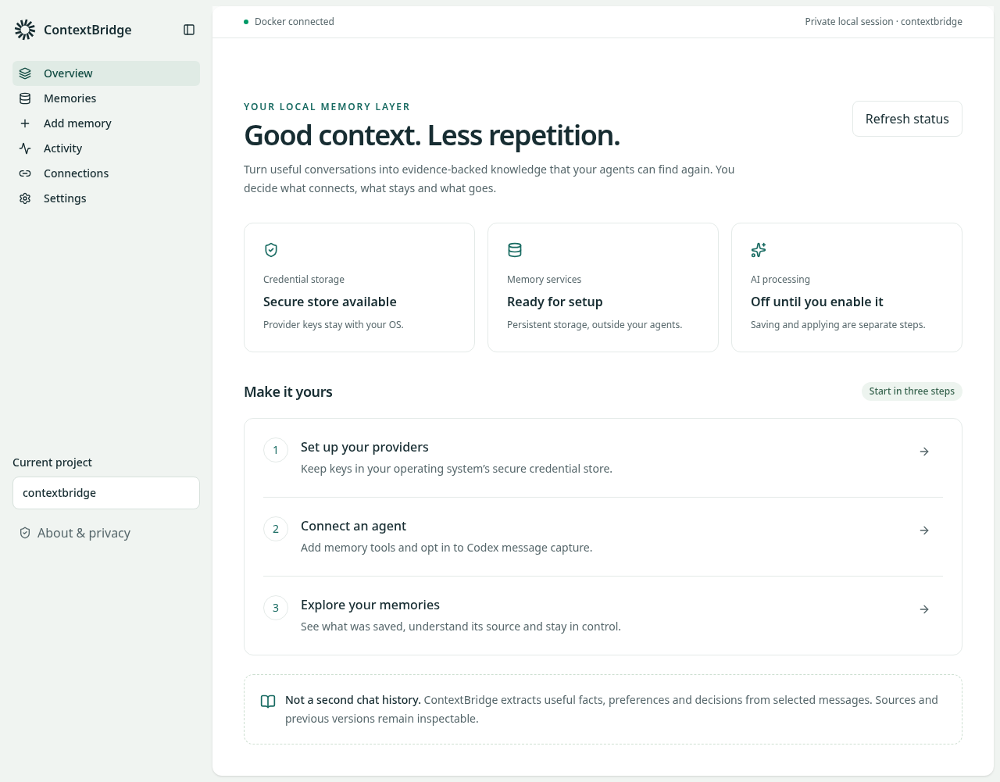
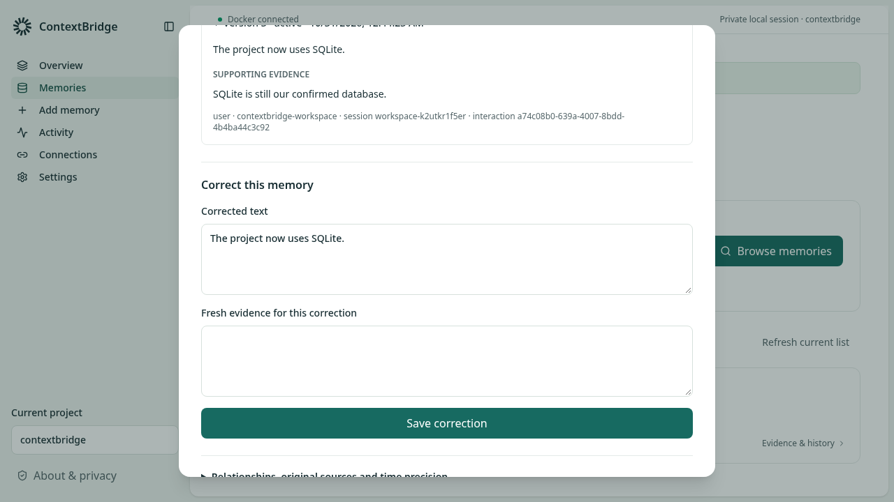
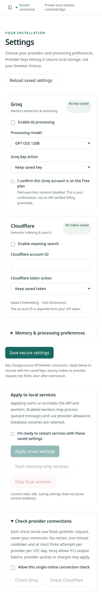
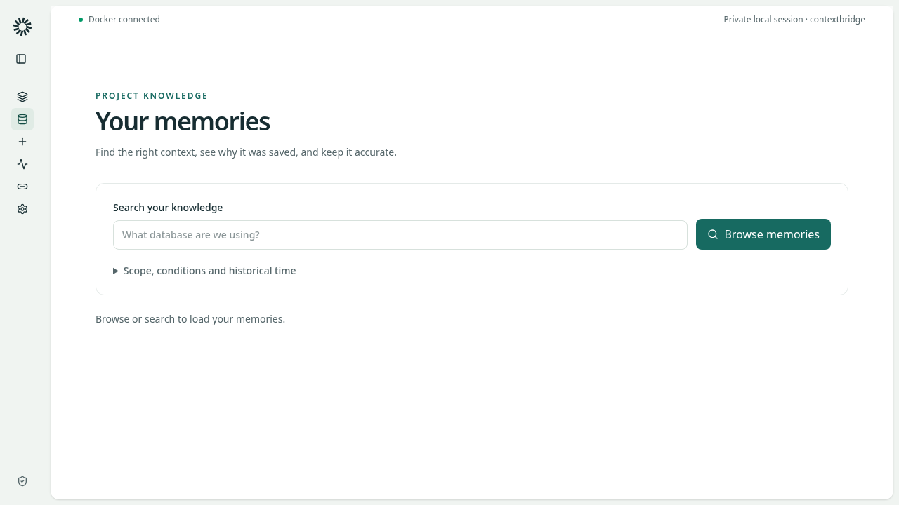
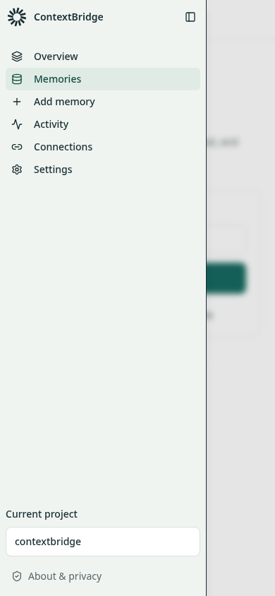
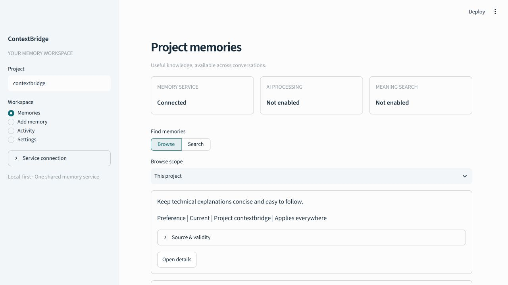
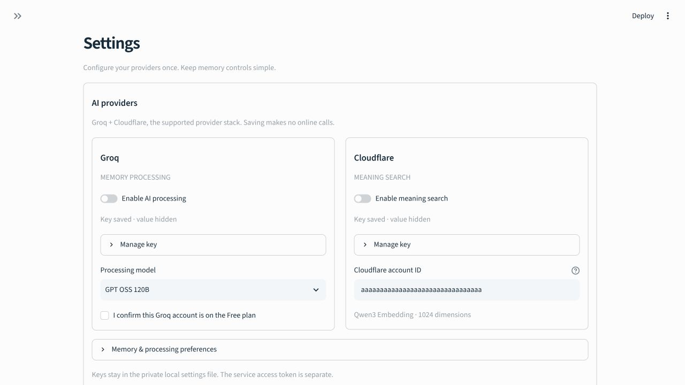
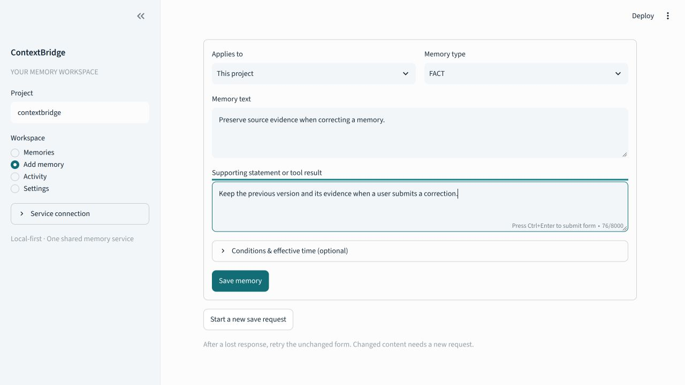
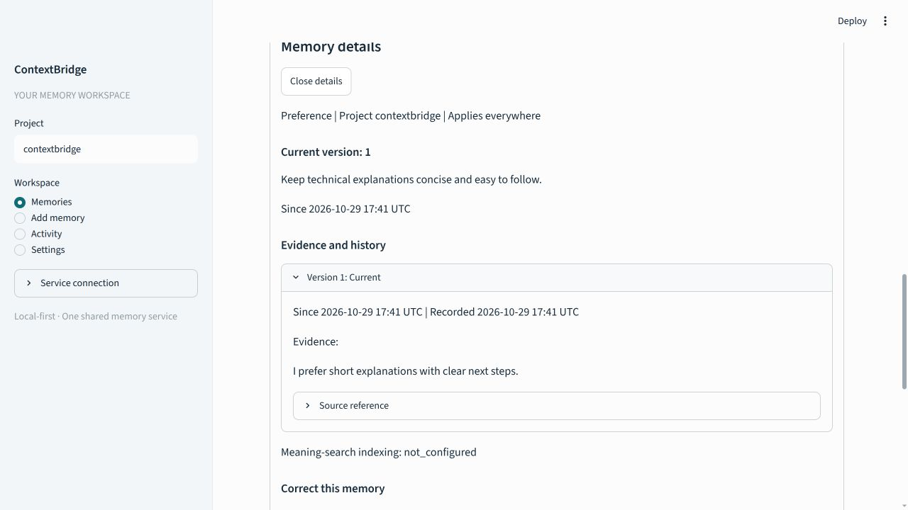
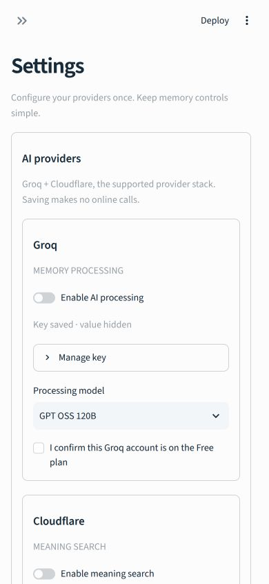

# Local product workspace screenshots

Captured from the built Next.js workspace in Chromium on 31 October 2026.
All data and credentials are synthetic. Memory CRUD/history uses the real shared
API and a dedicated PostgreSQL test database. The browser fixture simulates native
credential storage and Docker status; the screenshots do not prove those systems.
Separate native Linux vault and disposable Docker probes cover those paths.

The sidebar is the official Blocks.so **Sidebar Dashboard Inset (`sidebar-02`)**,
with ContextBridge navigation and project controls. Source, original registry payload,
licence and adaptation notes are retained in `frontend/vendor/blocks-so`.

Desktop and mobile automated axe scans passed; this does not replace first-user
or assistive-technology review. The seven browser workflows also cover stale edits,
project draft isolation and provider-secret clearing.

---

# ContextBridge interface screenshots

These images are ready to include in the project report with the captions below.
They are **actual browser captures of the implemented workspace**, not mockups.
The capture used a separate migrated PostgreSQL `_test` database, the real memory
API and synthetic user statements. Only synthetic, unusable provider-key fixtures
and a dummy Cloudflare account ID were used. No private user memory, real key or
live-provider result is shown. AI processing/meaning search were deliberately off;
the visible states report that honestly.

## Figure 1 — Project memory workspace

The selected project has bounded memory cards with visible type, scope and
applicability. Source metadata is available on demand. Sidebar navigation separates
browsing, adding information, activity and settings.

## Figure 2 — Local provider and BYOK settings

Groq processing and Cloudflare meaning search have separate controls. Existing
keys are represented only by a saved/hidden status; account ID and model are
distinct from credentials. Saving settings does not initiate an online call.
The navigation is collapsed in this view.

## Figure 3 — Explicit evidence-backed save

The user selects scope/type and provides the knowledge plus its supporting
statement. Conditions/time are optional and collapsed. This capture shows a
synthetic draft; submitting it was separately verified to create a durable record
through the actual UI/API.

## Figure 4 — Evidence and version inspection

The detail view shows the current claim, validity and preserved supporting evidence.
Full source references are available separately, and the correction workflow keeps
earlier versions. This is an existing synthetic preference, distinct from Figure 3's
save example. Search indexing is truthfully shown as not configured in this fixture.

## Figure 5 — Narrow layout

At a 390 × 844 viewport, provider cards stack and retain native labelled controls.
The heading remains below the fixed toolbar. This is a responsive browser check,
not proof of testing on every mobile device or a full accessibility audit.

## Supporting checks and capture limits

The images were captured on 29 October 2026. Desktop captures are 1280 × 720 JPEGs;
the narrow capture is 390 × 844. Some views are scrolled to show the relevant task.
They show the development browser toolbar; the standard setup launcher uses the
minimal toolbar. No image generation, compositing, fake success messages or
credential redaction was used: real key values were never present.

The real UI/API/database test covers save → inspect → correct → retire → restore →
forget. HTTP-substitute tests cover connection success/failure, single-request
bounds and safe messages. The [apply record](settings-apply-verification.json)
records actual root Compose configuration checks for API/worker/scheduler and two
successful apply/recreate commands against an isolated disposable Redis Compose
fixture. It does **not** claim the user's full running stack or live providers were
reconfigured. The fixture was removed afterward.

To repeat with your own approved data, follow [local workspace setup](../local-workspace.md).
Use a dedicated synthetic installation for shareable screenshots; never put real
credentials in report images. Independent usability/accessibility, Windows Docker
Desktop, real-provider quality and final release acceptance remain separate gates.
